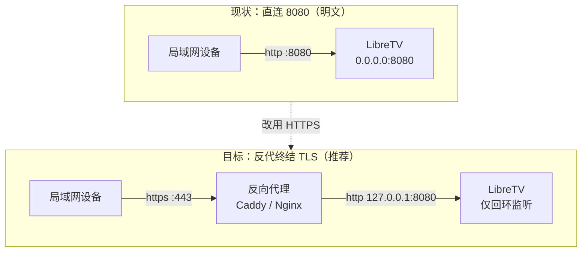

# LibreTV 局域网 HTTPS 反向代理配置指南

> 在 Windows 主机上为自部署的 LibreTV 套上 HTTPS，让手机、电视、平板等局域网设备安全访问。
> 给出 Caddy 与 Nginx 两套可直接复制的配置，以及证书签发、信任与排错步骤。

| 项目 | 值 |
| --- | --- |
| 适用版本 | LibreTV 2.19.2（Next.js 15） |
| 宿主环境 | Windows 10 / 11 |
| 后端监听 | `127.0.0.1:8080` |
| 对外端口 | `443`（`80` 用于跳转） |

**目录**

1. [为什么局域网也需要 HTTPS](#1-为什么局域网也需要-https)
2. [部署前准备](#2-部署前准备)
3. [用 mkcert 签发受信证书](#3-用-mkcert-签发受信证书)
4. [方案一：Caddy 反向代理](#4-方案一caddy-反向代理)
5. [方案二：Nginx for Windows](#5-方案二nginx-for-windows)
6. [防火墙与网络收口](#6-防火墙与网络收口)
7. [验证清单与排错](#7-验证清单与排错)
8. [环境变量与安全速查](#8-环境变量与安全速查)

---

## 1. 为什么局域网也需要 HTTPS

LibreTV 的生产模式通过环境变量 `PASSWORD` 做登录校验，登录成功后下发 `ltv_session` 会话 cookie（httpOnly、SameSite=Lax、有效期 90 天）。它**不是简单的“内网就无所谓”**：密码、会话令牌、以及搜索/直播流的请求都会在网络中以明文形态出现，同一个 Wi-Fi 下的任何设备都能嗅探到。

更关键的是这个项目对 cookie `Secure` 标记的处理方式，它直接决定了“能不能登录”：

| 判定顺序 | 条件 | 结果 |
| --- | --- | --- |
| 1（最高） | 环境变量 `COOKIE_SECURE=true` / `false` | 强制按该值设置 |
| 2（默认） | 请求头 `x-forwarded-proto` 的第一段是否为 `https` | `https` → Secure=on；缺失或为 `http` → Secure=off |

由此可以推出两条实际结论，它们直接决定你的部署选择：

- **直连 `http://192.168.x.x:8080` 时反而“能登录”**——因为没有该请求头，应用把 cookie 判为非 Secure，浏览器照常保存。代价是全程明文。
- **一旦走了 HTTPS 反代，就必须把 `X-Forwarded-Proto: https` 正确传给后端**。如果反代终结了 TLS 却没有传这个头，应用会认为“用户侧是 http”，此时若你又在 `.env` 里设了 `COOKIE_SECURE=true`，就会出现经典的“密码正确却反复弹回登录页”——登录接口返回成功，但带 `Secure` 的 cookie 被浏览器丢弃了。

> **注意**
> 项目官方文档也明确要求：生产部署必须由 Nginx / Caddy 等反向代理终结 HTTPS 后再转发到 8080，否则会话 cookie 会被浏览器丢弃 [^1][^2]。本指南的目标拓扑正是如此。



*图 1：两种访问路径对比。改造后只有反向代理对外，LibreTV 退回回环地址。*

---

## 2. 部署前准备

### 2.1 确认后端与端口

LibreTV 用 `npm start` 启动，脚本为 `next start -p 8080`，默认监听 `0.0.0.0:8080`，因此局域网内可以直接用 `http://<本机IP>:8080` 打开。

```powershell
# 查看本机局域网 IP（示例为 192.168.1.48，下文请替换成你的）
ipconfig | Select-String "IPv4"

# 确认后端存活
curl.exe -s http://127.0.0.1:8080/api/status
```

上一条命令会返回形如 `{"passwordRequired":true,"verified":false,"version":"2.19.2", ...}` 的 JSON，可用于核对版本与密码是否已配置。

> **建议**
> 上线 HTTPS 后，**不要把 8080 继续暴露给局域网**——否则任何人都能绕过 HTTPS 直连明文端口。做法是让 LibreTV 只监听回环地址，把 `package.json` 的 start 脚本改为：
>
> `"start": "next start -H 127.0.0.1 -p 8080"`
>
> 注意：这样改之后，本机也必须通过 `https://localhost` 访问（走反代），直接访问 `http://localhost:8080` 会连接失败。

### 2.2 固定 IP 与主机名

证书是按域名/IP 签发的，IP 变了证书就失效，因此先做两件事：

- **固定 IP**：在路由器里给这台主机做 DHCP 保留，或在 Windows 里设静态 IP。
- **准备一个主机名**（可选但强烈推荐）：很多设备（电视、手机）输入 IP 容易记错，可在路由器 DNS 或 hosts 里加一条，例如 `libretv.home.arpa` → `192.168.1.48`。下文配置同时包含 IP 与主机名，签证书时两者都要写进 SAN。

### 2.3 检查 .env

后端必须存在 `PASSWORD`，否则站点会提示管理员未配置。与本次改造相关的键如下：

| 变量 | 是否必填 | 说明 |
| --- | --- | --- |
| `PASSWORD` | 必填 | 访问密码，明文只存在于服务端 |
| `PROXY_SECRET` | 建议 | 会话签名密钥，`openssl rand -hex 32` 生成；不设置则从 PASSWORD 派生，改密码会导致全员掉线 |
| `COOKIE_SECURE` | 可选 | 强制覆盖 cookie 的 Secure 标记（`true`/`false`）。**正常配置好反代后不需要它**，仅在反代未正确传递 `X-Forwarded-Proto` 且无法修改反代时用作兜底 |
| `LIVE_ALLOW_PRIVATE` | 可选 | 设为 `1` 才允许直播代理访问内网地址（自建 IPTV 源场景），默认关闭以维持 SSRF 防护 |

```ini
PASSWORD=换成一个足够强的密码
PROXY_SECRET=换成一个随机 64 位十六进制串
# 反代配置正确时不要设置 COOKIE_SECURE
```

改完 `.env` 后需要重启 `npm start` 才生效（Next.js 在启动时读取环境变量）。

---

## 3. 用 mkcert 签发受信证书

局域网没有公网域名，Let's Encrypt 签不了（它不支持 IP 地址），所以主流做法是**自建一个本地根证书（CA）**：用它签出的证书，只要各设备装一次根证书，浏览器就不会再警告。`mkcert` 就是做这件事最省心的工具 [^3]。

### 3.1 安装 mkcert

```powershell
# 任选一种；winget 找不到 id 时先执行 winget search mkcert
winget install --id FiloSottile.mkcert
# choco install mkcert
# scoop install mkcert

# 手动方式：从 GitHub Releases 下载 mkcert-v*-windows-amd64.exe，改名 mkcert.exe 放进 PATH
# 新开一个终端后确认
mkcert -version
```

### 3.2 生成根证书并签发站点证书

1. 安装本地根证书到 Windows 信任库（会弹一次权限确认）：

   ```powershell
   mkcert -install
   ```

2. 在证书目录（示例 `C:\libretv-proxy\certs`）里签发证书，**把 IP 和主机名都写进去**：

   ```powershell
   New-Item -ItemType Directory -Force C:\libretv-proxy\certs | Out-Null
   cd C:\libretv-proxy\certs

   mkcert -cert-file libretv.pem -key-file libretv-key.pem `
     192.168.1.48 libretv.home.arpa localhost 127.0.0.1

   # 查看根证书位置：rootCA.pem 就在这里，后面要拷给手机/平板
   mkcert -CAROOT
   ```

3. 拿到两个文件：`libretv.pem`（证书，含 IP 与主机名 SAN）和 `libretv-key.pem`（私钥）。私钥不要外传，`.gitignore` 里排掉。

> **更换 IP 要重新签发**
> 证书里绑的是 `192.168.1.48` 这个字符串，不是“任意局域网 IP”。路由器重新分配了地址后，访问会报证书名称不匹配，需要重新执行上面的 `mkcert` 命令并重启反代。

### 3.3 让各设备信任根证书

本机执行过 `mkcert -install` 就已经受信。其他设备需要手动装一次根证书（`mkcert -CAROOT` 打印的目录下那个 `rootCA.pem`）：

| 设备 | 安装方式 |
| --- | --- |
| Windows | 双击 `rootCA.pem` → 安装证书 → 存储位置选“本地计算机”或“当前用户” → 手动指定存储到“受信任的根证书颁发机构” |
| iPad / iPhone | 先把文件 AirDrop 或邮件发过去，设置 → 已下载描述文件 → 安装；随后**必须**再到 设置 → 通用 → 关于本机 → 证书信任设置，为该根证书打开“完全信任” |
| Android | 文件改成 `rootCA.crt` 后缀 → 设置 → 安全 → 加密与凭据 → 安装证书 → CA 证书。部分机型入口名称不同（凭据存储 / 安装证书） |
| macOS | 把 `rootCA.pem` 拖进“钥匙串访问”→“系统”，双击该证书并把“使用此证书时”改为“始终信任” |
| 智能电视 / 盒子 | 多数内置浏览器会直接报错且不给跳过。可尝试在设备设置里导入 CA 证书；若设备不支持，见第 7 章“不想折腾证书”的替代方案 |

> **替代做法**
> 若不想在每台设备装根证书，也可以改用 Caddy 的内置 CA（配置里写 `tls internal` 即可自动签发），但要生效同样需要把 Caddy 的根证书装到各设备——信任这件事无法跳过，只是由谁签发的问题。

---

## 4. 方案一：Caddy 反向代理

Caddy 的优势是配置极短、自动处理 HTTP→HTTPS 跳转与各类转发头，适合“只想快点跑起来”的场景 [^4]。

### 4.1 安装

```powershell
# 方式一：winget（找不到 id 时先 winget search caddy）
winget install --id CaddyServer.Caddy

# 方式二：官网下载单文件 caddy_windows_amd64.exe，改名 caddy.exe 放进 PATH
caddy version
```

### 4.2 Caddyfile

新建 `C:\libretv-proxy\Caddyfile`，内容如下（把 IP 与主机名换成你自己的）：

```caddyfile
libretv.home.arpa, 192.168.1.48, localhost {
	# 使用 mkcert 签发的证书（写绝对路径，用正斜杠）
	tls C:/libretv-proxy/certs/libretv.pem C:/libretv-proxy/certs/libretv-key.pem

	reverse_proxy 127.0.0.1:8080 {
		# 关键：不要缓冲响应，SSE 与直播流才能实时透传
		flush_interval -1
		transport http {
			read_timeout 1h
			write_timeout 1h
		}
	}

	log {
		output file C:/libretv-proxy/caddy-access.log
	}
}
```

**这几行的作用：**

- `tls <cert> <key>`：直接指定 mkcert 生成的证书，不用 Caddy 自己签。若你更愿意让 Caddy 自签，替换为 `tls internal`。
- **`flush_interval -1` 是本方案最重要的一行**：它关闭响应缓冲。项目的搜索、换源测速、直播测活都通过流式响应逐条推送结果，直播流更是长连接，一旦被反代缓冲，前端就会一直转圈、直播会卡住。
- `read_timeout / write_timeout 1h`：把上游读写超时放宽到 1 小时，避免直播看一会儿被切断。
- Caddy 会**自动**把客户端的 `Host`、`X-Forwarded-For`、`X-Forwarded-Proto` 转发给后端，无需手工配置——这正是后端判定 cookie Secure 所需要的。

> **不要加 encode**
> Caddy 的 `encode` 指令（gzip/zstd）会引入压缩缓冲，可能拖慢流式接口。本站没有需要压缩的大静态资源，**建议不加**；如果加了，请确保流式接口不被压缩缓存。

### 4.3 启动

```powershell
# 前台运行，便于看日志；Ctrl+C 停止
caddy run --config C:\libretv-proxy\Caddyfile

# 或后台运行 / 停止
caddy start --config C:\libretv-proxy\Caddyfile
caddy stop

# 开机自启：Caddy 在 Windows 没有内置服务模式，可用 nssm 或 sc.exe 把上面的命令包装成服务
```

启动后，Caddy 会自动监听 443 并在 80 端口上做 HTTP→HTTPS 跳转。用浏览器打开 `https://libretv.home.arpa` 或 `https://192.168.1.48` 即可。

---

## 5. 方案二：Nginx for Windows

如果本机已经在跑 Nginx（或你更习惯 Nginx 的写法），用下面这份配置。它与 Caddy 方案等价，只是流式与超时相关的指令需要显式写出 [^5]。

### 5.1 准备 Nginx

1. 从 nginx.org 下载 Windows 版（zip），解压到 `C:\nginx`。
2. 把第 3 章生成的 `libretv.pem` 与 `libretv-key.pem` 放进 `C:\nginx\certs\`。
3. 编辑 `C:\nginx\conf\nginx.conf`，把下面的内容粘贴进已有的 `http { ... }` 块中，替换掉默认的 `server` 段。

### 5.2 nginx.conf

```nginx
# 上游：LibreTV 后端，保持长连接有助于流式响应
upstream libretv_upstream {
    server 127.0.0.1:8080;
    keepalive 32;
}

server {
    listen       443 ssl;
    http2        on;                # nginx < 1.25.1 请改用 listen 443 ssl http2;
    server_name  libretv.home.arpa 192.168.1.48;

    ssl_certificate     C:/nginx/certs/libretv.pem;
    ssl_certificate_key C:/nginx/certs/libretv-key.pem;
    ssl_protocols       TLSv1.2 TLSv1.3;
    ssl_session_cache   shared:SSL:10m;
    ssl_session_timeout 1h;

    # —— 必须：告诉后端用户侧是 HTTPS，否则 cookie 的 Secure 判定会出错 ——
    proxy_set_header Host              $host;
    proxy_set_header X-Real-IP         $remote_addr;
    proxy_set_header X-Forwarded-For   $proxy_add_x_forwarded_for;
    proxy_set_header X-Forwarded-Proto $scheme;

    # HTTP/1.1 + 清空 Connection，避免流式响应被缓冲或挂住
    proxy_http_version 1.1;
    proxy_set_header Connection        "";

    # —— 流式接口与直播长连接：不缓冲、不超时 ——
    proxy_buffering         off;
    proxy_request_buffering off;
    proxy_max_temp_file_size 0;
    proxy_read_timeout      3600s;
    proxy_send_timeout      3600s;

    location / {
        proxy_pass http://libretv_upstream;
    }
}

# 80 端口统一跳转到 HTTPS
server {
    listen 80;
    server_name libretv.home.arpa 192.168.1.48;
    return 301 https://$host$request_uri;
}
```

**为什么这几项和 LibreTV 有关：**

- **`X-Forwarded-Proto $scheme`**：后端用它决定会话 cookie 是否带 `Secure`。漏了它，HTTPS 站点可能被后端当成 HTTP 处理，出现登录状态异常。
- **`X-Forwarded-For`**：后端按该头的第一个值做“同一 IP 10 次/10 分钟”的登录限流。不传的话，所有局域网设备会被算成同一个 IP（即反代地址），**互相挤占登录次数**。
- **`proxy_buffering off`**：搜索、换源测速、直播测活都是逐条推送的流式响应。项目自身已经为这些响应打了 `X-Accel-Buffering: no`，Nginx 默认配置下即可生效；这里再显式关闭，可避免叠加其它代理时又被缓冲。
- **`proxy_read_timeout 3600s`**：默认 60 秒。直播流走的是长连接代理，60 秒无数据就会被 Nginx 掐断，表现为“看几十秒就断”。
- **`proxy_max_temp_file_size 0`**：禁止把大响应落到磁盘临时文件，观看/下载视频时更省 IO。

### 5.3 启动与重载

```powershell
cd C:\nginx

.\nginx.exe -t          # 先校验配置语法
.\nginx.exe             # 启动（后台驻留）
.\nginx.exe -s reload   # 改完配置后平滑重载
.\nginx.exe -s quit     # 停止
```

> **别开 gzip 压这些接口**
> 如果你在 Nginx 里配置了 `gzip_types`，请不要把 `application/x-ndjson` 加进去——它是流式接口的内容类型，压缩会引入缓冲、破坏“逐条到达”的效果。

---

## 6. 防火墙与网络收口

### 6.1 放行 443 与 80

以管理员身份运行 PowerShell：

```powershell
New-NetFirewallRule -DisplayName "LibreTV HTTPS 443" -Direction Inbound -Action Allow -Protocol TCP -LocalPort 443
New-NetFirewallRule -DisplayName "LibreTV HTTP 80"   -Direction Inbound -Action Allow -Protocol TCP -LocalPort 80
```

### 6.2 收回 8080 的对外暴露

改造完成前若为 8080 放过入站规则，现在应该删掉，并让 LibreTV 只监听回环（见 2.1 节）。

```powershell
# 先查看有没有和 8080 相关的规则
Get-NetFirewallRule | Where-Object DisplayName -like "*8080*" | Select-Object DisplayName, Enabled

# 确认后删除（把规则名换成上面查到的名字）
Remove-NetFirewallRule -DisplayName "LibreTV 8080"
```

### 6.3 检查是否真的收口了

在**另一台**局域网设备上执行（用你的实际 IP）：

```powershell
# 应当失败（连接被拒绝 / 超时）
Test-NetConnection 192.168.1.48 -Port 8080

# 应当成功
Test-NetConnection 192.168.1.48 -Port 443
```

---

## 7. 验证清单与排错

### 7.1 五项验证

1. **证书链正确**：用根证书校验，不应出现证书错误。

   ```powershell
   $ca = Join-Path (mkcert -CAROOT) 'rootCA.pem'
   curl.exe --cacert "$ca" -I https://192.168.1.48/api/status
   # 期望：HTTP/2 200
   ```

2. **登录成功且 cookie 带 Secure**：浏览器打开站点，输入密码进入首页；开发者工具 → Application → Cookies → `ltv_session`，检查 `Secure` 与 `HttpOnly` 均为勾选状态。
3. **搜索流式返回**：搜索一个片名，Network 面板找到 `search` 请求，响应应当**逐条追加上去**，而不是整段等齐后一次性出现。
4. **直播长连接稳定**：进入“直播”页播放任意频道，连续观看 1 分钟以上不中断。
5. **手机端可用**：同一 Wi-Fi 下用手机浏览器打开，无证书警告、能登录、能播放。

### 7.2 常见问题

| 现象 | 原因 | 处理 |
| --- | --- | --- |
| 密码正确却反复回到登录页 | cookie 被判为 Secure 但浏览器实际用 http 访问；或 `.env` 里设了 `COOKIE_SECURE=true` 却用 http 打开 | 坚持用 https 访问；确认反代传了 `X-Forwarded-Proto: https`；临时兜底可在 `.env` 设 `COOKIE_SECURE=false` 后重启 |
| 搜索一直转圈、结果不出现 | 反代缓冲了流式响应 | 确认 `flush_interval -1`（Caddy）或 `proxy_buffering off`（Nginx）已生效；不要对 `application/x-ndjson` 开 gzip |
| 直播播几十秒后中断 | 反代默认读超时 60 秒 | `proxy_read_timeout 3600s` / Caddy `read_timeout 1h` |
| 浏览器仍提示证书不受信任 | 设备未安装 mkcert 根证书，或装完没启用信任 | 按 3.3 节安装 `rootCA.pem`；iOS 别忘了“证书信任设置”里的完全信任开关 |
| 提示“尝试次数过多，请 10 分钟后再试” | 触发了“同一 IP 10 次 / 10 分钟”的登录限流 | 等 10 分钟；并确认反代传了 `X-Forwarded-For`，否则所有设备共用一个 IP 更容易触发 |
| 手机能开首页但搜索结果为空 | 未登录（cookie 未建立）或未添加任何点播源 | 先在“设置 → 源管理 → 点播源”添加采集接口；确认已登录 |
| 封面图大量裂图 | 图片代理被反代缓冲/超时 | 同“流式缓冲”一条；也可在站点设置里切换封面加载方式为直连 |
| 换了网络后打不开 | IP 变了，证书 SAN 不匹配 | 重新签发证书并重启反代（见 3.2 节） |

> **不想折腾证书？**
> 若设备是电视盒子这类“装不了根证书”的终端，可考虑改用 **Tailscale**（设备组网后自带可信证书与域名）或 **Cloudflare Tunnel**（把本地 8080 映射到一个公网 HTTPS 域名，无需公网 IP、无需自签证书）。两者都能避开“每台设备装 CA”，代价是流量要经过第三方或需要额外账号。

---

## 8. 环境变量与安全速查

### 8.1 与本次改造相关的键

| 变量 | 默认 | 建议值 | 作用 |
| --- | --- | --- | --- |
| `PASSWORD` | 无（未设则站点不可用） | 强密码 | 访问密码，服务端恒定时间比对 |
| `PROXY_SECRET` | 从 PASSWORD 派生 | `openssl rand -hex 32` | 会话与代理签名密钥；显式设置后改密码不会导致会话异常 |
| `COOKIE_SECURE` | 按 `x-forwarded-proto` 推导 | 不设置 | 强制覆盖 cookie 的 Secure 标记，仅在反代无法传头时兜底 |
| `REQUEST_TIMEOUT` | 8000 | 8000 | 代理上游请求超时（毫秒） |
| `MAX_RETRIES` | 1 | 1 | 代理上游请求重试次数 |
| `LIVE_ALLOW_PRIVATE` | 关闭 | 按需 | 设为 `1` 才允许直播代理访问内网地址（自建 IPTV） |

### 8.2 收尾检查

- **只开放 443（和用于跳转的 80）**，关闭 8080 的入站，并让后端只监听 `127.0.0.1`。
- **不要把 443 直接映射到公网**：本站没有针对公网的加固，暴露出去等于把家庭网络开放给扫描器。真要从外网访问，用 VPN/Tailscale 或 Cloudflare Tunnel。
- **私钥与 `.env` 不要提交到仓库**，确认在 `.gitignore` 中。
- **定期轮换密码与 PROXY_SECRET**；轮换 PROXY_SECRET 会让所有设备需要重新登录一次。
- 证书有效期到期前重新签发（mkcert 默认签出的证书有效期约 2 年多）。

> **一句话总结**
> 让 Caddy 或 Nginx 在 443 上终结 TLS、把 `X-Forwarded-Proto` 与 `X-Forwarded-For` 传给 `127.0.0.1:8080`，并关闭流式响应的缓冲与 60 秒读超时——这四点做到，局域网 HTTPS 就稳了。

---

## 参考资料

[^1]: LibreSpark/LibreTV 仓库 README，部署章节：生产环境必须通过 HTTPS 访问，否则会话 cookie 被丢弃。<https://github.com/LibreSpark/LibreTV>
[^2]: LibreTV 官方部署文档（wiki）：生产建议与反向代理说明。<https://libretv.is-an.org/wiki/Deployment.html>
[^3]: mkcert —— 一条命令生成受本地信任的开发证书（本地 CA 方案）。<https://github.com/FiloSottile/mkcert>
[^4]: Caddy 官方文档：reverse_proxy 指令（flush_interval、transport 超时）。<https://caddyserver.com/docs/caddyfile/directives/reverse_proxy>
[^5]: nginx 官方文档：ngx_http_proxy_module（proxy_buffering、proxy_read_timeout 等）。<https://nginx.org/en/docs/http/ngx_http_proxy_module.html>
